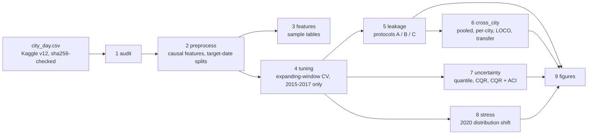

# Leakage-Free, Uncertainty-Aware PM2.5 Forecasting for Indian Cities

*A leakage-audited, cross-city and calibrated benchmark for daily PM2.5 forecasts in five Indian cities, built as one reproducible pipeline.*

**Same-day estimation with a random split reports MAE 12.8 µg/m³. The genuine leakage-free forecast for 2019 has MAE 15.3 (h = 1) to 24.6 µg/m³ (h = 7), and conformal calibration with online adaptation (CQR + ACI) lifts 90 % interval coverage from 0.806 to 0.888.**


-eb6834)


## Overview

Many published PM2.5 "forecasts" mix up three different things:
- estimating today's value from today's co-pollutants;
- scoring on randomly shuffled days;
- forecasting genuinely from what is known at the forecast origin.

This repository separates them and asks three questions with one pipeline:

1. **Leakage:** how much do a random split and same-day inputs flatter the reported error?
2. **Cross-city:** does a model pooled over cities help? How well does it carry over to a city it never trained on?
3. **Uncertainty:** do quantile intervals keep their nominal 90 % coverage? Do split conformal (CQR) and adaptive conformal inference (ACI) fix that?

A 2020 stress test then reruns the same pipeline through the COVID-19 period, which brought a strong distribution shift.
The project is a survey plus a small benchmark, so no new learning algorithm is proposed.

## Gaps addressed

- **Leakage made visible.** Protocols A (random split, same-day inputs), B (chronological split, same-day inputs) and C (genuine forecast) are run side by side, with an explicit statement of what each comparison does and does not isolate.
- **Strictly causal features.** Every input is knowable at the forecast origin, and the splits use target dates. Executable tests perturb the future and confirm that no feature changes.
- **Honest cross-city claims.** Leave-one-city-out and transfer cities are labelled as held-out-city generalisation with local history, not zero-shot.
- **Calibrated uncertainty under shift.** Raw quantiles, CQR and CQR + ACI are scored on identical rows. A calibration-ready rule prevents the use of calibration scores before they could have been observed.
- **Full provenance.** Every table carries the dataset hash, config hash and package versions, and the whole pipeline reruns bit-for-bit.

## Pipeline



1. **audit:** verifies the raw file (hash, rows, cities, dates, columns), then writes PM2.5 completeness and gap tables.
2. **preprocess:** builds the forecasting table (one row per city, origin and horizon) and the same-day table used by protocols A/B.
3. **features:** writes the sample-count, missingness and A/B split-share tables.
4. **tuning:** selects LightGBM hyperparameters with two expanding folds inside 2015–2017 and checks the choice against the config.
5. **leakage:** runs protocols C, B and A (5 seeds), plus their comparison and diagnostics.
6. **cross_city:** fits per-city and leave-one-city-out models and applies the pooled models to three transfer cities.
7. **uncertainty:** fits quantile models, calibrates CQR on 2018 and runs one delayed-feedback ACI stream per city × horizon.
8. **stress:** reruns the point forecast and the interval pipeline with train 2015–2018, calibration 2019 and test 2020-01-01 to 2020-07-01, then runs read-only diagnostics.
9. **figures:** draws 16 figures from the saved outputs.

## Experiments and models

| Experiment | Train / calibrate / test | Compared |
|---|---|---|
| Leakage audit | 2015–2017 / — / 2019 (A: random 80/20 of 2015–2017 ∪ 2019) | A vs B (split), B vs C (task) |
| Cross-city | 2015–2017 / — / 2019 | pooled vs per-city vs LOCO; external transfer |
| Uncertainty | 2015–2017 / 2018 / 2019 | raw quantile vs CQR vs CQR + ACI, also for held-out cities |
| 2020 stress test | 2015–2018 / 2019 / 2020 H1 | the same point and interval models, pre-lockdown vs lockdown periods |

| Model | Definition |
|---|---|
| Persistence | ŷ[t+h] = y[t] |
| Seasonal naive | ŷ[t+h] = y[t+h−7] |
| LightGBM point | Direct model per h ∈ {1, 3, 7}: 500 trees, num_leaves 15, min_child_samples 50, no early stopping |
| LightGBM quantile | The same, with quantile objective at 0.05 / 0.95 |
| CQR | Interval [q05 − q̂, q95 + q̂], with q̂ the conformal quantile of 2018 scores per horizon |
| CQR + ACI | alpha_{t+1} = alpha_t + γ(0.10 − err_t), γ = 0.02, alpha_t ∈ [0.01, 0.30]; updated only once the target is observed |

## Data and splits

- **Dataset:** [Air Quality Data in India (2015–2020)](https://www.kaggle.com/datasets/rohanrao/air-quality-data-in-india) by Vopani, version 12, CC0, compiled from CPCB. Only `city_day.csv` is used.
- **Cities:**
  - core: Delhi, Lucknow, Chennai, Hyderabad, Bengaluru;
  - transfer only: Kolkata, Mumbai;
  - optional transfer: Visakhapatnam.

```
2015 ─────── 2017 │ 2018        │ 2019        │ 2020-01 ── 2020-07
main:    train    │ calibration │ test        │
stress:  train ──────────────── │ calibration │ test (pre_lockdown | lockdown from 03-25)
```

- **Splits use the target date,** so an h = 7 forecast never crosses a boundary.
- **Inputs:** PM2.5 at the origin, lags of 1, 2, 3 and 7 days, rolling mean/std over 3, 7 and 14 days, and target-date calendar features.
- **Missing values:** inputs are forward-filled for at most 2 days; targets are never filled.
- **Excluded inputs:** AQI, AQI_Bucket and the co-pollutants are never inputs to a forecast.

## Quick start

Download `city_day.csv` from the Kaggle page above into `data/raw/`. Its sha256 must be
`0d84b21c3e4878bbad8df362f2ab05f61ad959538dddf5918e714077ed3c1847`.

macOS / Linux:

```bash
python3.11 -m venv .venv && source .venv/bin/activate
pip install -r requirements.txt
shasum -a 256 data/raw/city_day.csv
python run.py all          # every stage, then outputs/result_manifest.csv
python run.py uncertainty  # or any single stage: audit, preprocess, features, tuning,
                           # leakage, cross_city, uncertainty, stress, figures
pytest -q                  # 345 tests
```

Windows PowerShell:

```powershell
py -3.11 -m venv .venv; .venv\Scripts\Activate.ps1
pip install -r requirements.txt
Get-FileHash data\raw\city_day.csv -Algorithm SHA256
python run.py all
pytest -q
```

On an Apple-silicon laptop, `python run.py all` takes about 40 s and `pytest -q` about 30 s.
The stages run in order: each reads what the previous ones wrote.

## Repository layout

```
run.py                     single entry point (stages in order or by name)
configs/experiments.yaml   every path, split, feature, model and stage setting
src/data_audit.py          config, hashing, provenance sidecars, raw-data checks, completeness audit
src/preprocessing.py       city roles, daily series, bounded forward fill
src/features.py            causal features, same-day table, sample tables
src/splits.py              target-date splits, random split for protocol A, tuning folds and guards
src/models.py              baselines, LightGBM parameters, leakage guards, fit / predict / save / load
src/metrics.py             MAE, RMSE, R², skill, PICP, MPIW, Winkler
src/conformal.py           conformity scores, conformal quantile, CQR interval, ACI stream
src/experiments.py         shared readers, scoring on identical rows, tuning
src/leakage_protocols.py   protocols A / B / C
src/leakage.py             A-vs-B and B-vs-C comparison, diagnostics, figures
src/cross_city.py          pooled, per-city, LOCO, transfer
src/intervals.py           quantile models, calibration-ready rule, CQR, ACI columns, interval metrics
src/uncertainty.py         strata, held-out cities, tables, figures
src/stress_forecasts.py    2020 frames, audit, point and interval forecasts
src/stress.py              2020 diagnostics, figures, result manifest
src/figures.py             matplotlib figure helpers
tests/                     one test file per module (345 tests)
docs/                      design.md, results.md, outputs.md
data/raw/                  city_day.csv (read-only, not committed)
data/processed/, outputs/  regenerated by run.py
```

## Outputs and how to read them

- **`outputs/tables/`:** one CSV per result. In it:
  - `n` is the number of scored rows;
  - `mask_type = common_eval_mask` means every method was scored on identical rows;
  - `low_n` flags cells with n < 30.
- **`outputs/predictions/`:** row-level predictions. Calibration rows are present for transparency but never scored.
- **`outputs/models/`:** LightGBM text models, each with metadata (training range, rows, cities, parameters, hashes).
- **`outputs/figures/`:** 16 PNGs drawn from the tables.
- **Sidecars:** every file has a `.meta.json` with the dataset sha256, Kaggle version, config hash, package versions and git commit.

See [docs/outputs.md](docs/outputs.md) for every file group.

## Headline results

All figures are for 2019, the five core cities and identical rows per comparison; error units are µg/m³ ([docs/results.md](docs/results.md)).

| | h = 1 | h = 3 | h = 7 |
|---|---|---|---|
| LightGBM forecast (C), MAE | 15.31 | 22.76 | 24.61 |
| Persistence, MAE | 15.16 | 23.31 | 26.89 |
| Skill vs persistence, RMSE | 0.063 | 0.077 | 0.150 |
| Leave-one-city-out vs pooled, MAE change | +3.4 % | +3.2 % | +1.6 % |
| Per-city vs pooled, MAE | 17.07 vs 15.31 | 25.57 vs 22.76 | 27.14 vs 24.61 |

| 90 % intervals (n = 5,435) | PICP | MPIW | Winkler |
|---|---|---|---|
| Raw quantile LightGBM | 0.806 | 63.1 | 120.0 |
| CQR | 0.877 | 71.3 | 114.9 |
| CQR + ACI | 0.888 | 78.2 | 110.5 |

- **Same-day estimation:** B (chronological) has MAE 10.98, and A (random split, 5 seeds) has MAE 12.78 ± 0.33. On matched 2019 city-dates, A's MAE is 22.2 % lower than B's.
- **Extreme days:** coverage on the top-10 % pollution days falls to 0.81 / 0.65 / 0.45 for CQR + ACI at h = 1 / 3 / 7.
- **2020 stress test:** CQR + ACI covers 0.907 of pre-lockdown and 0.908 of lockdown rows.

## Limitations

- Only five core cities and one public dataset; there are no meteorological inputs.
- Forecasts are daily and point-in-time. No ARIMA, deep-learning or hierarchical baselines are included.
- CQR assumes exchangeability, which autocorrelated daily data and the 2020 shift violate. ACI guarantees only long-run marginal coverage, approximately, since alpha_t is bounded.
- Coverage on extreme days and in the post-monsoon season stays well below nominal. It is reported, not corrected.
- B vs C compares two different tasks, and A vs B differs in more than split type (test share and test period). Neither gap is a pure effect of one factor.
- Transfer and LOCO use each city's own recent PM2.5, so they are not zero-shot.
- The 2020 test is a partial year, and its periods differ in season as well as lockdown status, so it is not a causal study.
- One hyperparameter set is selected on 2015–2017 and reused everywhere; there is no per-experiment tuning.

## Reproducibility

- **Determinism:** a fixed seed (42), `deterministic` LightGBM, a single thread and pinned packages (`requirements.txt`). Two full runs produce byte-identical models and CSVs.
- **Config:** `configs/experiments.yaml` holds every setting, and its hash is stored with every output.
- **Model reuse:** saved quantile models are reloaded only if all their metadata match the current config and data. Otherwise the run stops.
- **Tests:** `pytest -q` checks causality (future perturbation), split boundaries, hand-computed metrics and ACI trajectories, and leakage guards. It also reruns each experiment against the saved outputs.
- **Design:** [docs/design.md](docs/design.md) records every design decision and the wording rules.

## License and citation

- License: *to be decided by the author*. The dataset is CC0.
- Citation: *placeholder: add the paper reference once available.*
